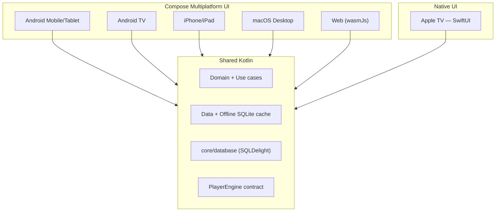

# OttPlatform — Compose Multiplatform OTT Demo

Modular, production-oriented **OTT streaming demo** built with **Kotlin Multiplatform** and **Compose Multiplatform (CMP)**.

Shared business logic and shared UI power Android (phone, tablet, TV), iOS, macOS Desktop, and **Web (`wasmJs`)**. **Apple TV uses SwiftUI** for UI (CMP does not officially support tvOS) while reusing Kotlin domain/data/player contracts.

## Demo Video (5 Platforms Running Together)

> **Live Web App:** [https://shyam1234.github.io/DemoComposeMultiPlatform/](https://shyam1234.github.io/DemoComposeMultiPlatform/)

[](https://github.com/shyam1234/DemoComposeMultiPlatform/blob/main/documentation/media/final-demo-with-web.mp4)

- **Watch / Download Full Demo Video (1080p MP4):** [`documentation/media/final-demo-with-web.mp4`](documentation/media/final-demo-with-web.mp4) ([Direct raw MP4](https://github.com/shyam1234/DemoComposeMultiPlatform/raw/main/documentation/media/final-demo-with-web.mp4))

## Start here — architecture docs

| Document | What you’ll learn |
|----------|-------------------|
| **[ARCHITECTURE.md](documentation/architecture/ARCHITECTURE.md)** | System overview, Clean Architecture, CMP strategy, Mermaid diagrams |
| [MODULE_STRUCTURE.md](documentation/MODULE_STRUCTURE.md) | Folders, Gradle modules, responsibilities |
| [DEPENDENCY_RULES.md](documentation/DEPENDENCY_RULES.md) | Allowed / forbidden module edges |
| [PLATFORM_SUPPORT.md](documentation/PLATFORM_SUPPORT.md) | Official support matrix & disclosures |
| [PLAYER_ARCHITECTURE.md](documentation/PLAYER_ARCHITECTURE.md) | `PlayerEngine`, Media3 / AVPlayer adapters |
| [FEATURE_EXTRACTION_GUIDE.md](documentation/FEATURE_EXTRACTION_GUIDE.md) | Enable / disable / extract features safely |
| [TESTING_GUIDE.md](documentation/TESTING_GUIDE.md) | Unit, UI, and platform test strategy |
| [BUILD_AND_RUN.md](documentation/BUILD_AND_RUN.md) | JDK, Gradle, run commands |
| [API.md](documentation/API.md) | Play-CMS API definitions, extensibility & engineering job roles |
| [ARCHITECTURE_DECISIONS.md](documentation/ARCHITECTURE_DECISIONS.md) | ADRs and trade-offs |
| [FEASIBILITY_CHECK.md](documentation/FEASIBILITY_CHECK.md) | CMP UI, network, database & production readiness benchmarks |

## Architecture at a glance



## Design pillars

1. **Clean Architecture** — UI → domain ← data; domain stays platform-free  
2. **Feature modules** — `features/<name>/api` + `impl` for independent extraction  
3. **CMP first** — shared UI on officially supported targets  
4. **Native playback** — Media3 on Android, AVPlayer on Apple platforms  
5. **Testable by default** — fakes + `commonTest` without devices  

## Independence checks

| Check | Intent |
|-------|--------|
| Remove Search feature | Home / Player must still build |
| Replace ExoPlayer binding | Player UI unchanged |
| Run domain tests on JVM | No Android/iOS device required |

## Tech stack

- Kotlin **2.4.21** · Compose Multiplatform **1.11.1** (AGP 8.10 / compileSdk 36)
- Coroutines · Serialization · Ktor · Koin
- **SQLDelight 2.4.1** (`:core:database` — Android, iOS, Desktop SQLite drivers) + `localStorage` persistence on Web (`wasmJs`) for **offline-only** catalog mirroring (network-first sync + prune of removed CMS rows) & persistent watchlist
- Media3 ExoPlayer (Android) · AVPlayer (iOS) · HTML5 `<video>` + `hls.js` (`platform/web`) · FakePlayerEngine (desktop/tests)
- **Play-CMS** (`https://cms.play-cms.com`) dynamic auth, menus, layouts, rails, and rich artwork

## Demo data: Play-CMS API

Live dynamic OTT catalog from **Play-CMS** (internal login handshake via `CmsAuthManager` with automatic `401` token refresh):

- Login: `POST https://cms.play-cms.com/v1/login?devicetype=atv_ott`
- Menu: `GET https://cms.play-cms.com/v1/menu?devicetype=androidTV&lang_code=en`
- Layout: `GET https://cms.play-cms.com/v1/layouts/{layoutId}`
- Rails: `GET https://cms.play-cms.com/v2/rails?id={railId}`

See [API.md](documentation/API.md) for full API schemas, `ImageSlot` / dynamic menu extensibility, and engineering job roles.

## Run

```bash
export JAVA_HOME=/usr/local/opt/openjdk@17/libexec/openjdk.jdk/Contents/Home
./gradlew :apps:androidApp:assembleDebug
./gradlew :apps:androidTvApp:assembleDebug
./gradlew :apps:desktopApp:run
./gradlew :apps:webApp:wasmJsBrowserDistribution
```

**Web (`wasmJs`):** serves at `http://localhost:8080/` locally and deploys to GitHub Pages via `.github/workflows/deploy-web.yml` (`https://shyam1234.github.io/DemoComposeMultiPlatform/`).

**iOS:** open `apps/iosApp/iosApp.xcodeproj` in full Xcode, set a Development Team, run on a **physical device** (Intel simulators are not supported). Details: [BUILD_AND_RUN.md](documentation/BUILD_AND_RUN.md) · [apps/iosApp/README.md](apps/iosApp/README.md).

## Unit tests (executed)

```bash
./gradlew testDebugUnitTest desktopTest --console=plain
```

**Passed on this machine:** 23 suites / **46 tests passed** (0 failures, 0 errors, 0 skipped) — covering `CmsCatalogMapper` (incl. thematic `Rail_Background_Image` aspect), `CmsCatalogRepository` (login, `401` refresh, layout switching, network-first prune, offline fallback), `ImageResolver`, `GetMenuUseCase`, `GetLayoutFeedUseCase`, `SearchChannelsUseCase`, SQLDelight catalog/menu/layout/watchlist persistence, `AppMenuViewModel`, `HomeViewModel`, `PlayerViewModel`, and `PlayerController`.

## Status

Android phone/tablet/TV + Desktop + **Web (`wasmJs`)** + **iOS device** (CMP + AVPlayer + SQLDelight v3 offline mirror) are verified against the live Play-CMS backend (`7` rails, `33` assets across dynamic menus and layouts; local DB / `localStorage` used only when offline). Thematic branded rails and discovery-dock tabs are CMS-driven. Apple TV remains SwiftUI + shared KMP (not CMP UI).

## Official references

- [Compose Multiplatform platforms](https://kotlinlang.org/docs/multiplatform/compose-compatibility-and-versioning.html)
- [KMP architecture](https://kotlinlang.org/docs/multiplatform/multiplatform-architecture.html)
- [Android TV quality](https://developer.android.com/develop/adaptive-apps/quality-guidelines/tv-app-quality)
- [tvOS HIG](https://developer.apple.com/design/human-interface-guidelines/designing-for-tvos)
