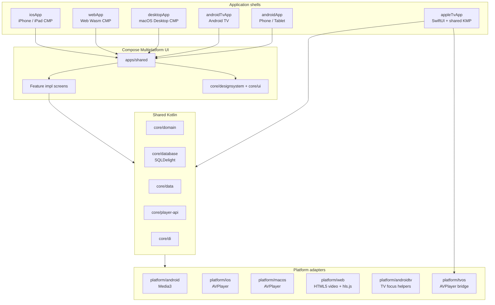
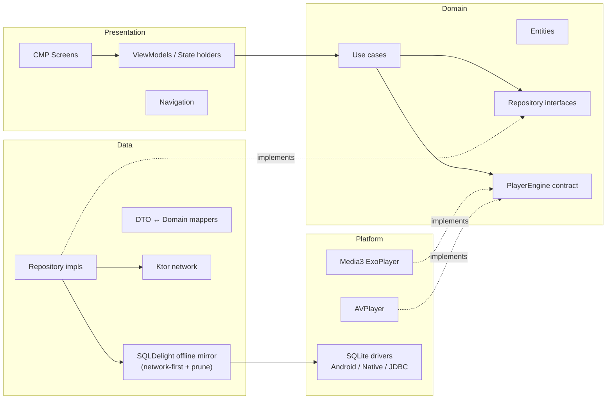
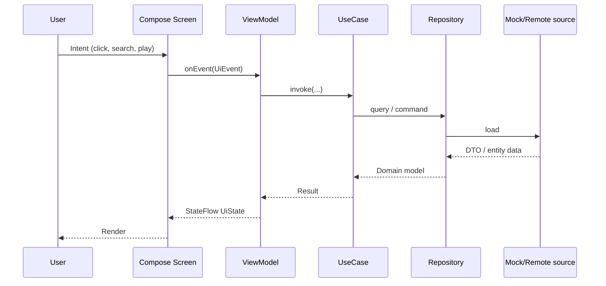
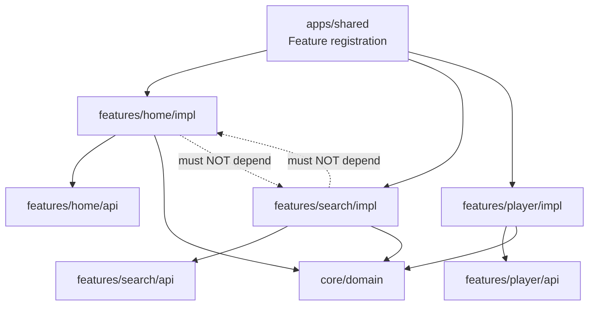
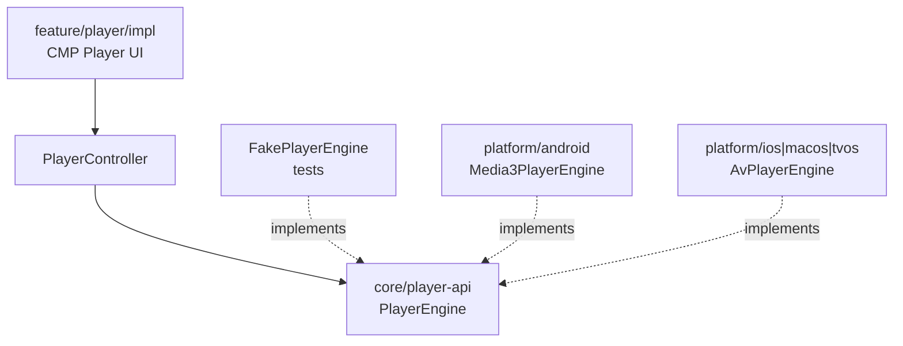
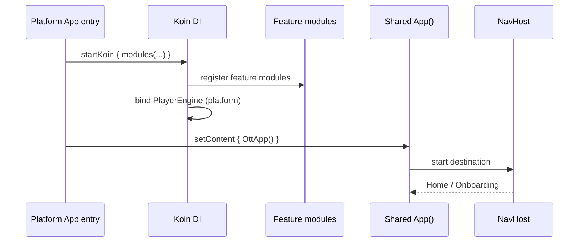

# Architecture Overview

**OttPlatform** is a modular OTT (streaming) demo built with **Kotlin Multiplatform (KMP)** and **Compose Multiplatform (CMP)**. Shared business logic and shared UI live in common modules; media playback and Apple TV UI stay platform-native where required.

## Goals

| Goal | How we achieve it |
|------|-------------------|
| Share business logic | Domain + data + use cases in `commonMain` |
| Share UI where official | CMP on Android, iOS, macOS Desktop |
| Native where needed | Player engines; SwiftUI for Apple TV |
| Feature independence | `features/<name>/api` + `features/<name>/impl` |
| Testability | Fakes, contracts, common unit tests |
| Production shape | Clean Architecture, DI registration, documented boundaries |

## High-level system

## Clean Architecture layers

Dependency direction is always **inward toward domain**. UI and data never leak into domain.

### Layer rules

| Layer | May depend on | Must not depend on |
|-------|---------------|--------------------|
| Presentation | Domain APIs, design system, feature APIs | Data impls, ExoPlayer, AVPlayer, SQL |
| Domain | Kotlin stdlib, coroutines, datetime | Android, iOS, Compose, Ktor, Koin (optional pure) |
| Data | Domain interfaces, network, serialization | Compose UI, feature screens |
| Platform | Domain/player contracts | Feature UI modules |

## Compose Multiplatform strategy

| Target | UI technology | Notes |
|--------|---------------|-------|
| Android Mobile / Tablet | **CMP** | Adaptive layouts, bottom / nav rail |
| Android TV | **CMP** | Dedicated TV focus / D-pad UX |
| iPhone / iPad | **CMP** | Official stable CMP iOS |
| macOS Desktop | **CMP Desktop (JVM)** | Window + keyboard/mouse |
| Web (`wasmJs`) | **CMP Web (Wasm)** | Responsive (`>= 840dp` top nav, `< 840dp` bottom nav) + `hls.js` |
| Apple TV (tvOS) | **SwiftUI** | CMP does **not** officially support tvOS UI |

Shared Kotlin (domain, data, player contracts, use cases) is reused on tvOS via a KMP framework. UI for Apple TV is native.

## Unidirectional data flow

- **UiState** is immutable.
- **UiEvent** is the only way screens talk to ViewModels.
- Side effects (navigation, snackbars) are one-shot events, not duplicated in state when avoidable.

## Feature modularity

Each feature is split into:

- **`api`** — public routes, models, ports other modules may use
- **`impl`** — screens, ViewModels, Koin module; depended on only by app composition roots

**Validation checks**

1. Remove Search: delete `:features:search:impl` registration → Home and Player still compile.
2. Replace ExoPlayer: swap `platform/android` player binding → player UI unchanged.
3. Test domain without devices: run `commonTest` on JVM.

## Player architecture (summary)

Common code never imports ExoPlayer or AVPlayer. See [PLAYER_ARCHITECTURE.md](../PLAYER_ARCHITECTURE.md).

## Application startup

Features are enabled by **explicit Koin registration** in the app shell, not by scattered feature flags.

## Related docs

| Document | Purpose |
|----------|---------|
| [MODULE_STRUCTURE.md](../MODULE_STRUCTURE.md) | Folder / Gradle module map |
| [DEPENDENCY_RULES.md](../DEPENDENCY_RULES.md) | Allowed / forbidden edges |
| [PLATFORM_SUPPORT.md](../PLATFORM_SUPPORT.md) | Support matrix & limitations |
| [PLAYER_ARCHITECTURE.md](../PLAYER_ARCHITECTURE.md) | Playback contracts & adapters |
| [FEATURE_EXTRACTION_GUIDE.md](../FEATURE_EXTRACTION_GUIDE.md) | How to remove or extract a feature |
| [TESTING_GUIDE.md](../TESTING_GUIDE.md) | Unit / UI / platform test strategy |
| [BUILD_AND_RUN.md](../BUILD_AND_RUN.md) | Build & run commands |
| [API.md](../API.md) | Play-CMS API definitions, extensibility & job roles |
| [ARCHITECTURE_DECISIONS.md](../ARCHITECTURE_DECISIONS.md) | ADRs / trade-offs |
| [FEASIBILITY_CHECK.md](../FEASIBILITY_CHECK.md) | CMP production feasibility & benchmarks |
